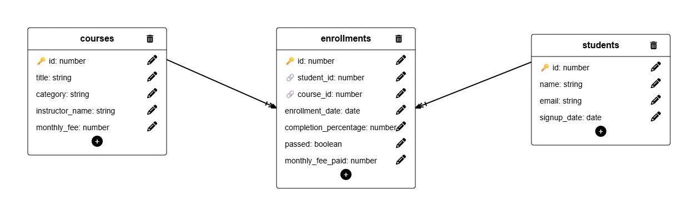

# Auditoría de datos de EduTrack con tablas relacionadas

**Base de datos:** EduTrack v2 (normalizada) · **Motor:** PostgreSQL en Supabase · **Consultas:** [`queries.sql`](queries.sql) · **Diagrama:** [`diagram.png`](diagram.png)

---

## 1. Introducción

EduTrack es una plataforma de formación online que gestiona estudiantes, cursos e inscripciones. En su versión 2, la base de datos está normalizada en tres tablas: el nombre del instructor ya no se repite en cada inscripción y se almacena una sola vez en la tabla de cursos.

Este informe recoge la auditoría SQL realizada sobre esa base de datos. Las diez consultas de [`queries.sql`](queries.sql) se ejecutaron en el SQL Editor de Supabase y **todos los resultados que aparecen aquí son los devueltos por Supabase**. Las cifras derivadas (porcentajes, totales) se calculan a partir de esos resultados y se indican como tales.

Antes de las consultas se comprobó la importación del dataset original (`edutrack_v2.sql`):

| Tabla | Registros |
|---|---|
| `students` | 8 |
| `courses` | 7 |
| `enrollments` | 16 |

## 2. Objetivo de la auditoría

Responder a las necesidades de la responsable de operaciones mediante consultas que combinan las tres tablas:

- Conocer las inscripciones, los aprobados y el progreso de los estudiantes.
- Evaluar el rendimiento por instructor.
- Detectar estudiantes y cursos sin actividad.
- Identificar a los estudiantes con varias inscripciones.
- Estimar los ingresos mensuales por categoría.
- Verificar la integridad referencial entre las tablas.

Todas las consultas utilizan al menos un `JOIN`, no contienen subconsultas y son de solo lectura.

## 3. Modelo relacional

### `students`

| Columna | Tipo | Restricciones |
|---|---|---|
| `id` | `SERIAL` | **PK** |
| `name` | `VARCHAR(100)` | `NOT NULL` |
| `email` | `VARCHAR(150)` | `NOT NULL`, `UNIQUE` |
| `signup_date` | `DATE` | `NOT NULL` |

### `courses`

| Columna | Tipo | Restricciones |
|---|---|---|
| `id` | `SERIAL` | **PK** |
| `title` | `VARCHAR(150)` | `NOT NULL` |
| `category` | `VARCHAR(50)` | `NOT NULL` |
| `instructor_name` | `VARCHAR(100)` | Admite `NULL` |
| `monthly_fee` | `DECIMAL(6,2)` | `NOT NULL` |

### `enrollments`

| Columna | Tipo | Restricciones |
|---|---|---|
| `id` | `SERIAL` | **PK** |
| `student_id` | `INTEGER` | `NOT NULL`, **FK** → `students(id)` |
| `course_id` | `INTEGER` | `NOT NULL`, **FK** → `courses(id)` |
| `enrollment_date` | `DATE` | `NOT NULL` |
| `completion_percentage` | `INTEGER` | `NOT NULL`, `DEFAULT 0` |
| `passed` | `BOOLEAN` | `NOT NULL`, `DEFAULT FALSE` |
| `monthly_fee_paid` | `DECIMAL(6,2)` | `NOT NULL` |

## 4. Relaciones entre las tablas

| Relación | Cardinalidad | Significado |
|---|---|---|
| `students.id` → `enrollments.student_id` | **1 : N** | Un estudiante puede tener muchas inscripciones; cada inscripción pertenece a un único estudiante. |
| `courses.id` → `enrollments.course_id` | **1 : N** | Un curso puede tener muchas inscripciones; cada inscripción corresponde a un único curso. |
| `students` ↔ `courses` | **N : M** (indirecta) | Un estudiante puede cursar varios cursos y un curso puede tener varios estudiantes. La relación se resuelve con la tabla intermedia `enrollments`, que además guarda los datos propios de cada inscripción (fecha, progreso, aprobado, importe). |

En el diagrama, la marca de cardinalidad de cada línea está en el extremo de `enrollments` (lado "muchos"). No existe una línea directa entre `students` y `courses`: la relación N:M se representa mediante las dos relaciones 1:N.

En la base de datos de Supabase se confirmó que `enrollments` tiene configuradas estas restricciones (consulta exploratoria sobre `pg_constraint`, ajena a las diez consultas evaluables):

| Restricción | Definición |
|---|---|
| `enrollments_pkey` | `PRIMARY KEY (id)` |
| `enrollments_student_id_fkey` | `FOREIGN KEY (student_id) REFERENCES students(id)` |
| `enrollments_course_id_fkey` | `FOREIGN KEY (course_id) REFERENCES courses(id)` |

---

## 5. Resultados de las consultas

Alias utilizados en todas las consultas: `s` = `students`, `c` = `courses`, `e` = `enrollments`.

### Consulta 1 — Todas las inscripciones

- **Pregunta de negocio:** ¿qué estudiante está inscrito en qué curso y cuánto ha avanzado?
- **Tipo de JOIN:** `INNER JOIN` (`enrollments` → `students` y `enrollments` → `courses`).
- **Metodología:** se parte de `enrollments` y se une con las dos tablas relacionadas para sustituir los identificadores por el nombre del estudiante y el título del curso. Ordenado por estudiante y curso.

**Resultado (16 filas):**

| student_name | course_title | completion_percentage |
|---|---|---|
| Emily Watson | Advanced Python | 40 |
| Emily Watson | Intro to Python | 85 |
| Emily Watson | Web Design Basics | 60 |
| Klaus Weber | Data Analysis with SQL | 78 |
| Klaus Weber | Intro to Python | 92 |
| Lucia Fernandes | Advanced Python | 0 |
| Lucia Fernandes | Digital Marketing 101 | 3 |
| Lucia Fernandes | Web Design Basics | 5 |
| Marco Rossi | Advanced Python | 95 |
| Marco Rossi | Intro to Python | 88 |
| Pierre Dubois | Data Analysis with SQL | 20 |
| Pierre Dubois | UI/UX Fundamentals | 0 |
| Priya Sharma | Digital Marketing 101 | 70 |
| Priya Sharma | Intro to Python | 55 |
| Yuki Nakamura | Data Analysis with SQL | 45 |
| Yuki Nakamura | UI/UX Fundamentals | 0 |

**Interpretación:**

- Las 16 inscripciones tienen estudiante y curso válidos: el `INNER JOIN` no descarta ninguna.
- Hay 7 estudiantes con actividad y 6 cursos con alumnos. No aparecen Giulia Romano ni *Email Campaigns*, que no tienen inscripciones (consultas 4 y 5).
- *Intro to Python* es el curso con más inscripciones (4).
- El progreso es muy desigual: va del 0 % al 95 %, y 3 inscripciones están al 0 %.

**Observaciones:** Lucia Fernandes tiene tres cursos con un progreso muy bajo (0 %, 3 % y 5 %). Es un caso a seguir por riesgo de abandono.

### Consulta 2 — Estudiantes que han aprobado cursos

- **Pregunta de negocio:** ¿qué estudiantes han aprobado algún curso y cuál?
- **Tipo de JOIN:** `INNER JOIN` (`enrollments` → `students` y `enrollments` → `courses`).
- **Metodología:** misma unión que la consulta 1, filtrada con `WHERE e.passed = TRUE`. Un estudiante aparece una vez por cada curso aprobado.

**Resultado (6 filas):**

| student_name | student_email | passed_course_title |
|---|---|---|
| Emily Watson | emily.watson@student.edutrack.com | Intro to Python |
| Klaus Weber | klaus.weber@student.edutrack.com | Data Analysis with SQL |
| Klaus Weber | klaus.weber@student.edutrack.com | Intro to Python |
| Marco Rossi | marco.rossi@student.edutrack.com | Advanced Python |
| Marco Rossi | marco.rossi@student.edutrack.com | Intro to Python |
| Priya Sharma | priya.sharma@student.edutrack.com | Digital Marketing 101 |

**Interpretación:**

- Se han aprobado **6 de las 16 inscripciones** (37,5 %, cifra derivada).
- Los aprobados corresponden a **4 estudiantes distintos**. Klaus Weber y Marco Rossi han aprobado todos sus cursos (2 de 2).
- Lucia Fernandes, Pierre Dubois y Yuki Nakamura no han aprobado ningún curso.
- *Intro to Python* concentra la mitad de los aprobados (3 de 6).

**Observaciones:** al cruzar este resultado con el de la consulta 1, todas las inscripciones aprobadas tienen un progreso del 70 % o más, y ninguna no aprobada supera el 60 %. Los datos son coherentes, aunque el esquema no define ninguna regla que relacione `passed` con `completion_percentage`.

### Consulta 3 — Porcentaje medio de completado por instructor

- **Pregunta de negocio:** ¿qué instructores consiguen que sus estudiantes avancen más?
- **Tipo de JOIN:** `INNER JOIN` (`courses` → `enrollments`) + `GROUP BY`.
- **Metodología:** `ROUND(AVG(e.completion_percentage), 2)` agrupado por `c.instructor_name`, ordenado de mayor a menor. La media se calcula sobre las inscripciones, así que cada curso pesa según su número de alumnos. Los cursos sin inscripciones no intervienen, por el `INNER JOIN`.

**Resultado (4 filas):**

| instructor_name | avg_completion_percentage |
|---|---|
| Marta López | 66.14 |
| Carlos Vega | 40.00 |
| Lucia Prades | 36.50 |
| Pending assignment | 0.00 |

**Interpretación:**

- **Marta López tiene el mayor porcentaje medio de completado (66,14 %).** Imparte *Intro to Python* y *Data Analysis with SQL*.
- La media de Carlos Vega (40,00 %) esconde resultados muy dispares: en sus cursos hay inscripciones del 95 % y del 0 %.
- La media de Lucia Prades (36,50 %) corresponde solo a *Digital Marketing 101*. Su otro curso, *Email Campaigns*, no tiene inscripciones y no cuenta.

**Observaciones:** `Pending assignment` **no es un valor `NULL`**, sino un texto que indica que *UI/UX Fundamentals* aún no tiene instructor asignado. Por eso aparece como un grupo propio y no se ha filtrado. Sus 2 inscripciones están al 0 %. La consulta no permite concluir que la falta de instructor sea la causa, pero es una señal operativa clara.

### Consulta 4 — Estudiantes sin inscripciones

- **Pregunta de negocio:** ¿hay estudiantes registrados que no se han inscrito en ningún curso?
- **Tipo de JOIN:** `LEFT JOIN` (`students` → `enrollments`).
- **Metodología:** el `LEFT JOIN` conserva a todos los estudiantes. Los que no tienen inscripciones reciben `NULL` en las columnas de `enrollments`, y `WHERE e.id IS NULL` los aísla.

**Resultado (1 fila):**

| student_name | student_email |
|---|---|
| Giulia Romano | giulia.romano@student.edutrack.com |

**Interpretación:** **1 de los 8 estudiantes (12,5 %) no tiene ninguna inscripción.** Giulia Romano está registrada, pero no ha empezado ningún curso.

**Observaciones:** es una oportunidad de activación. Un `INNER JOIN` no habría mostrado este caso; el `LEFT JOIN` es imprescindible para detectar ausencias.

### Consulta 5 — Cursos sin inscripciones

- **Pregunta de negocio:** ¿hay cursos en el catálogo que nadie está cursando?
- **Tipo de JOIN:** `LEFT JOIN` (`courses` → `enrollments`).
- **Metodología:** mismo patrón que la consulta 4, desde `courses`, con `WHERE e.id IS NULL`.

**Resultado (1 fila):**

| course_title | course_category |
|---|---|
| Email Campaigns | Marketing |

**Interpretación:** **1 de los 7 cursos no tiene inscripciones:** *Email Campaigns*, de la categoría *Marketing* y con instructora asignada (Lucia Prades).

**Observaciones:** Marketing es la categoría con menos actividad: su otro curso, *Digital Marketing 101*, tiene 2 inscripciones (consulta 7). Conviene revisar la promoción o la vigencia de este curso.

### Consulta 6 — Estudiantes inscritos en más de un curso

- **Pregunta de negocio:** ¿qué estudiantes cursan varios cursos a la vez?
- **Tipo de JOIN:** `INNER JOIN` (`students` → `enrollments`) + `GROUP BY` + `HAVING`.
- **Metodología:** agrupación por estudiante (`s.id`, `s.name`) con `HAVING COUNT(DISTINCT e.course_id) > 1`. El `DISTINCT` cuenta cursos diferentes, no inscripciones.

**Resultado (7 filas):**

| student_name | enrolled_courses |
|---|---|
| Emily Watson | 3 |
| Lucia Fernandes | 3 |
| Klaus Weber | 2 |
| Marco Rossi | 2 |
| Pierre Dubois | 2 |
| Priya Sharma | 2 |
| Yuki Nakamura | 2 |

**Interpretación:**

- **Los 7 estudiantes con actividad están inscritos en más de un curso.**
- Emily Watson y Lucia Fernandes tienen 3 cursos cada una; el resto, 2.

**Observaciones:** la suma de cursos (3 + 3 + 2 × 5 = 16) coincide con el total de inscripciones, así que no hay inscripciones repetidas de un estudiante en el mismo curso. Aun así, el esquema no lo impide, porque no existe una restricción `UNIQUE (student_id, course_id)`.

### Consulta 7 — Ingresos mensuales teóricos por categoría

- **Pregunta de negocio:** ¿cuánto aporta cada categoría a los ingresos mensuales, con los precios actuales?
- **Tipo de JOIN:** `INNER JOIN` (`courses` → `enrollments`) + `GROUP BY`.
- **Metodología:** la fórmula es *número de inscripciones por curso × `courses.monthly_fee`*, sumado por categoría. El `JOIN` genera una fila por inscripción, de modo que `SUM(c.monthly_fee)` equivale exactamente a esa fórmula. Se usa el precio actual del curso, **no** `enrollments.monthly_fee_paid`.

**Resultado (4 filas):**

| course_category | total_enrollments | estimated_monthly_revenue |
|---|---|---|
| Programming | 7 | 409.93 |
| Data | 3 | 179.97 |
| Design | 4 | 169.96 |
| Marketing | 2 | 59.98 |

**Interpretación:**

- El total teórico mensual es **819,84** (suma derivada de las cuatro filas).
- **Programming aporta la mitad (50,0 %)**, con 7 de las 16 inscripciones. Le siguen Data (22,0 %), Design (20,7 %) y Marketing (7,3 %).
- Design tiene más inscripciones que Data (4 frente a 3), pero ingresa menos, porque sus cursos son más baratos (39,99 y 44,99 frente a 59,99).

**Limitaciones de la estimación:**

- Es una cifra **teórica**: aplica el precio **actual** a todas las inscripciones registradas. No son ingresos históricos cobrados ni ingresos netos (no descuenta impuestos, comisiones ni costes).
- El esquema no indica si una inscripción sigue activa: no hay fecha de baja ni estado. Las inscripciones van de 2024 a 2025, y la estimación supone que todas pagan la cuota actual.
- Si los precios cambian, la cifra cambia, aunque no se haya cobrado nada distinto.
- Revisando los `INSERT` del script original, en estos 16 registros `monthly_fee_paid` coincide con el `monthly_fee` actual de cada curso. Esto no se ha verificado con una de las diez consultas y no tiene por qué mantenerse en el futuro.

### Consulta 8 — Estudiantes inscritos por instructor

- **Pregunta de negocio:** ¿cuántos estudiantes distintos atiende cada instructor?
- **Tipo de JOIN:** `INNER JOIN` (`courses` → `enrollments`) + `GROUP BY`.
- **Metodología:** `COUNT(DISTINCT e.student_id)` agrupado por `c.instructor_name`. Un estudiante que sigue varios cursos del mismo instructor cuenta una sola vez. El `INNER JOIN` deja fuera a los instructores sin inscripciones.

**Resultado (4 filas):**

| instructor_name | enrolled_students |
|---|---|
| Marta López | 6 |
| Carlos Vega | 3 |
| Lucia Prades | 2 |
| Pending assignment | 2 |

**Interpretación:**

- **Marta López es la instructora con más estudiantes: 6 de los 7 estudiantes activos.** Combina el mayor alcance con la mayor media de completado (consulta 3).
- Carlos Vega tiene 3 estudiantes distintos para 5 inscripciones: dos de sus estudiantes (Emily Watson y Lucia Fernandes) siguen sus dos cursos.
- El curso pendiente de asignación ya tiene 2 estudiantes esperando instructor.

**Observaciones:** la suma de la columna (13) es mayor que el número de estudiantes activos (7), porque un mismo estudiante puede tener cursos con varios instructores. Estos totales no deben sumarse entre instructores.

### Consulta 9 — Inscripciones con `student_id` huérfano

- **Pregunta de negocio:** ¿hay inscripciones asociadas a estudiantes que no existen?
- **Tipo de JOIN:** `LEFT JOIN` (`enrollments` → `students`).
- **Metodología:** se conservan todas las inscripciones y `WHERE s.id IS NULL` deja solo aquellas cuyo `student_id` no encuentra estudiante.

**Resultado:** la consulta **se ejecutó** y devolvió **0 filas** (*Success. No rows returned*).

**Interpretación:** **no se han detectado inscripciones con `student_id` huérfano.**

### Consulta 10 — Inscripciones con `course_id` huérfano

- **Pregunta de negocio:** ¿hay inscripciones asociadas a cursos que no existen?
- **Tipo de JOIN:** `LEFT JOIN` (`enrollments` → `courses`).
- **Metodología:** mismo patrón que la consulta 9, con `WHERE c.id IS NULL`.

**Resultado:** la consulta **se ejecutó** y devolvió **0 filas** (*Success. No rows returned*).

**Interpretación:** **no se han detectado inscripciones con `course_id` huérfano.**

**Observaciones sobre las consultas 9 y 10:** son dos conclusiones distintas:

1. **No hay registros huérfanos ahora mismo.** Lo demuestran las consultas 9 y 10.
2. **Las restricciones impiden que aparezcan en el futuro.** Lo confirma la consulta exploratoria de la sección 4: `student_id` y `course_id` son `NOT NULL` y tienen claves foráneas activas en Supabase.

No se desactivó ninguna restricción ni se insertaron datos para forzar casos de prueba.

---

## 6. Principales hallazgos

| Indicador | Resultado | Consulta |
|---|---|---|
| Estudiantes con más de una inscripción | 7 de 7 estudiantes activos (Emily Watson y Lucia Fernandes, 3 cursos) | 6 |
| Cursos sin inscripciones | 1: *Email Campaigns* (Marketing) | 5 |
| Instructor con mayor porcentaje medio de completado | Marta López, 66,14 % | 3 |
| Cursos aprobados | 6 de 16 inscripciones, de 4 estudiantes distintos | 2 |
| Estudiantes sin inscripciones | 1: Giulia Romano | 4 |
| Ingresos mensuales teóricos por categoría | Programming 409,93 · Data 179,97 · Design 169,96 · Marketing 59,98 (total 819,84) | 7 |
| Instructores con más estudiantes | Marta López, 6 estudiantes distintos | 8 |
| Incidencias de integridad referencial | Ninguna: 0 huérfanos y claves foráneas activas | 9, 10 |

### Interpretación

1. **Alta implicación de los estudiantes activos.** Todos los que se han inscrito siguen al menos dos cursos. El reto no es la captación de inscripciones, sino que esas inscripciones terminen en aprobado: solo 6 de 16 lo consiguen.
2. **Marta López es la referencia del catálogo.** Tiene el mayor alcance (6 estudiantes) y el mayor progreso medio (66,14 %).
3. **Hay un curso sin instructor y sin progreso.** *UI/UX Fundamentals* figura como `Pending assignment` y sus 2 inscripciones están al 0 %. Es la alerta operativa más clara.
4. **Hay capacidad sin usar.** Giulia Romano no tiene cursos y *Email Campaigns* no tiene alumnos.
5. **Los ingresos dependen de Programming.** La mitad de los ingresos teóricos sale de dos cursos (*Intro to Python* y *Advanced Python*). Marketing es la categoría más débil en inscripciones e ingresos.
6. **Los datos son íntegros.** No hay registros huérfanos y las restricciones lo garantizan a nivel de esquema.

## 7. Conclusiones

La auditoría confirma que la base de datos normalizada de EduTrack es consistente: las tres tablas se relacionan correctamente mediante claves foráneas, no hay registros huérfanos y los casos especiales del dataset (un estudiante sin inscripciones, un curso sin alumnos y un curso sin instructor asignado) se detectan con las consultas adecuadas.

Desde el punto de vista técnico, la auditoría muestra la diferencia práctica entre los tipos de unión. El `INNER JOIN` es adecuado para analizar la actividad existente (consultas 1–3 y 6–8). El `LEFT JOIN` con `IS NULL` es necesario para encontrar lo que falta (consultas 4, 5, 9 y 10). Las agregaciones con `COUNT(DISTINCT ...)` evitan contar dos veces a la misma persona o al mismo curso.

**Recomendaciones para operaciones:**

- Asignar un instructor a *UI/UX Fundamentals* y hacer seguimiento de sus 2 estudiantes, ambos al 0 %.
- Contactar con Giulia Romano para que empiece un curso.
- Revisar la promoción o la continuidad de *Email Campaigns*.
- Acompañar a los estudiantes con progreso bajo en varios cursos, especialmente a Lucia Fernandes.
- No usar la estimación de la consulta 7 como dato contable: para ingresos reales hace falta un registro de pagos con fechas.

**Posibles mejoras del esquema** (solo recomendaciones, no se ha modificado el esquema original):

- Añadir `UNIQUE (student_id, course_id)` en `enrollments` para impedir inscripciones duplicadas.
- Añadir `CHECK (completion_percentage BETWEEN 0 AND 100)`.
- Crear una tabla `instructors` y referenciarla desde `courses`, en lugar de guardar el nombre como texto libre. Así se evita que una errata separe a un mismo instructor en dos grupos, y la falta de asignación se representa con `NULL` en lugar del texto `Pending assignment`.
